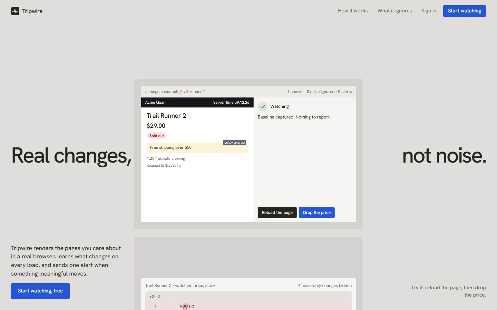
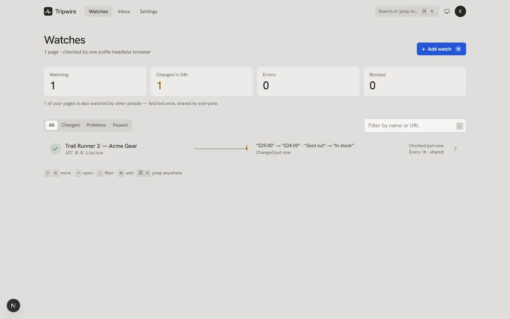
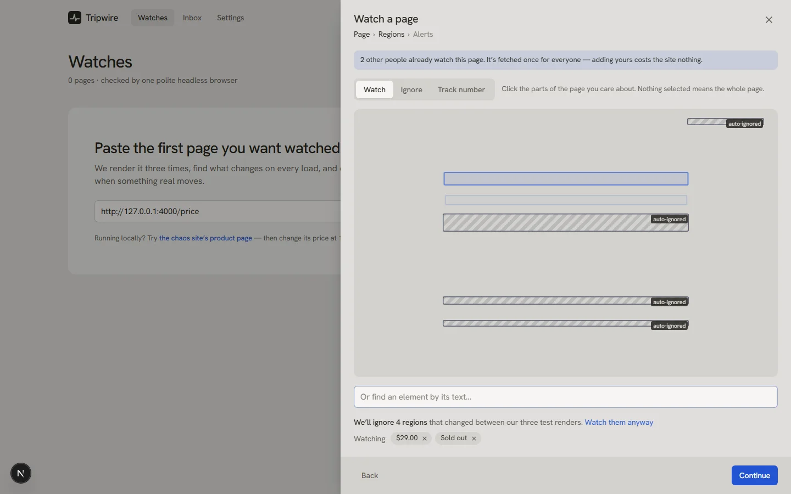
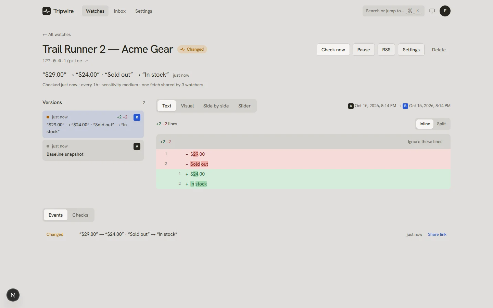
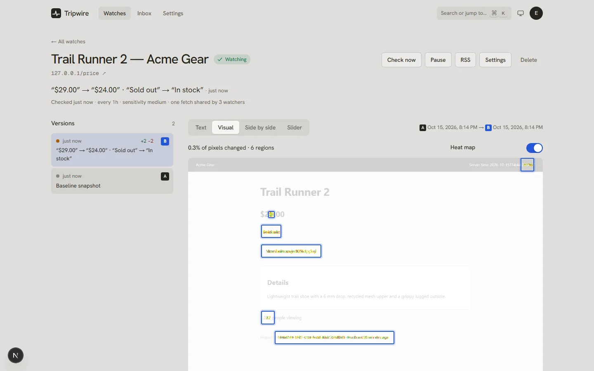
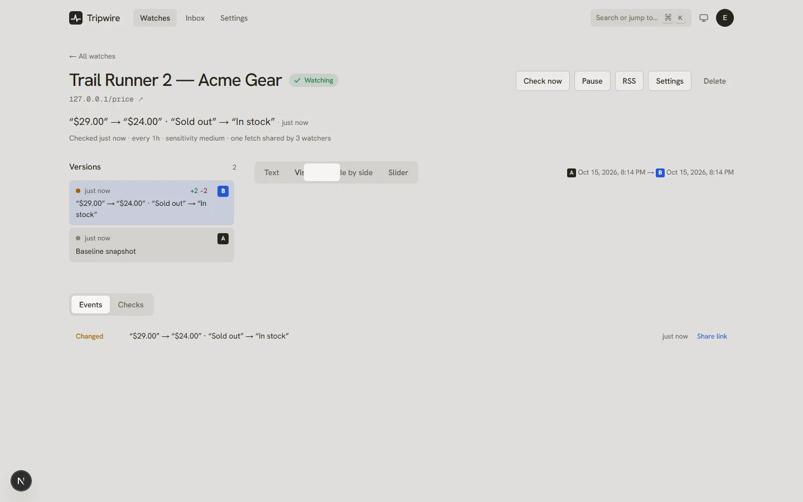
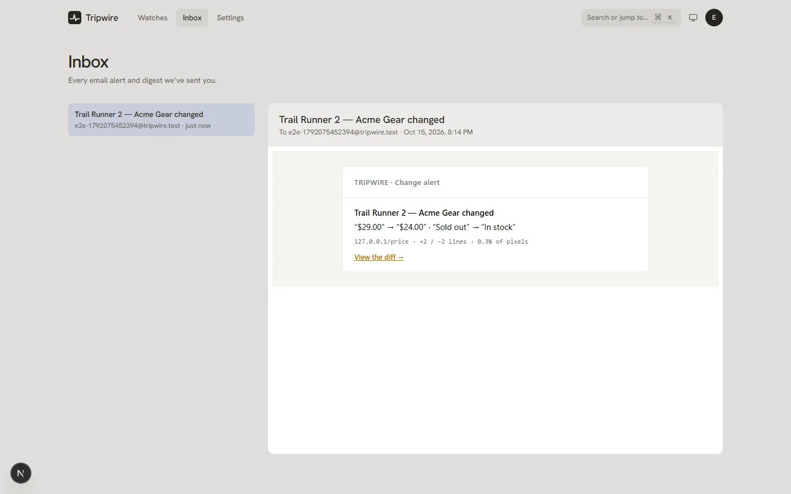
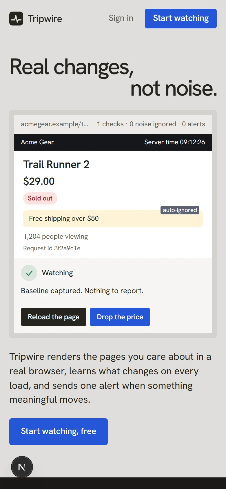

# Tripwire — Website Change Detector

> **Demo Round 1 project.** A service that monitors public web pages and alerts you to **meaningful** changes while ignoring noise: timestamps, counters, ads, rotating banners, random tokens, outages and CAPTCHAs.

**🔗 Live app: [tripwire.up.railway.app](https://tripwire.up.railway.app)** · sign up and start watching a page in under a minute.



Tripwire renders each page in a real headless browser and learns what changes on every load. It alerts you **once**, by email, Discord or Telegram, only when something you care about really moved. Each alert carries a one-line summary and a link to the diff.

---

## Contents

1. [The brief](#the-brief)
2. [How each requirement is met](#how-each-requirement-is-met)
3. [The four hard questions](#the-four-hard-questions)
4. [Screenshots](#screenshots)
5. [Live deployment](#live-deployment)
6. [Quick start](#quick-start)
7. [3-minute demo script](#3-minute-demo-script)
8. [Architecture](#architecture)
9. [How a check works](#how-a-check-works)
10. [Noise filtering, layer by layer](#noise-filtering-layer-by-layer)
11. [Bonus features](#bonus-features)
12. [Browser extension](#browser-extension)
13. [Design and UX](#design-and-ux)
14. [Testing](#testing)
15. [Configuration](#configuration)
16. [Security](#security)
17. [Known limitations](#known-limitations)
18. [Project structure](#project-structure)
19. [Credits](#credits)

---

## The brief

> **Goal:** build a service that monitors public web pages and alerts users to meaningful changes while ignoring noise.

**Core requirements**

1. Users add a URL, a name and a check interval (15 min to 24 h). Pages render in a headless browser.
2. Checks run through a scheduler and job queue with timeouts and retries. Public pages only, no stored credentials.
3. Each check saves page text and a screenshot. A new snapshot is stored only when the content hash changes.
4. Noise filtering for timestamps, counters, ads, rotating banners and random tokens, plus a sensitivity setting.
5. A visual picker to select regions to watch (saved as CSS selectors) and regions to ignore.
6. Text diff, highlighted screenshot diff, and side-by-side comparison of any two versions.
7. Alerts via email and Telegram/Discord webhook, with a summary and a diff link. No duplicates. Optional daily digest.
8. A per-page version timeline and a dashboard showing last checked, last changed and status (OK, error, blocked).

**Questions to answer:** Is a site outage or CAPTCHA a change? If 200 users watch the same URL, is it fetched 200 times? How do you avoid endless alerts on pages that differ on every load? How do you avoid hammering a site?

**Bonus:** keyword-only alerts, number tracking with charts, AI one-line change summaries, a browser extension, per-page RSS.

**All core requirements, all four questions and all five bonuses are implemented.**

---

## How each requirement is met

| # | Requirement | Implementation |
|---|---|---|
| 1 | URL, name, interval (15 m–24 h), headless rendering | Add-watch flow (`src/components/app/AddWatch.tsx`) with interval presets 15 m → 24 h, validated server-side (`src/server/schemas.ts`). Pages render in **Playwright Chromium** (`src/server/render.ts`). |
| 2 | Scheduler and job queue with timeouts and retries; public pages only | DB-backed queue (`src/server/queue.ts`) with leases, crash recovery, dedupe keys, exponential-backoff retries and job timeouts, driven by a scheduler loop (`src/worker/index.ts`). An SSRF guard refuses private, loopback and metadata addresses for every request. No login or credential fields exist. |
| 3 | Text and screenshot per check; snapshot only on hash change | Each render extracts visible text and a full-page screenshot. Snapshots are unique on `(target, content_hash)`, and screenshots are content-addressed (`src/server/storage.ts`), so unchanged pages store nothing new. A tiny `checks` row is logged every time. |
| 4 | Noise filtering and sensitivity | Seven layers, [described below](#noise-filtering-layer-by-layer): frozen clock and seeded randomness in the browser, ad/tracker blocking, regex normalizers, auto-calibration, rotation memory, a confirmation render and a flap guard. Sensitivity is low/medium/high. |
| 5 | Visual region picker (CSS selectors) | Click regions on Tripwire's own screenshot of the page to **Watch**, **Ignore** or **Track a number** (`src/components/app/Picker.tsx`). The renderer emits an element map with deterministic CSS selectors, and regions that changed during calibration arrive pre-marked as auto-ignored. |
| 6 | Text diff, highlighted screenshot diff, side-by-side of any two versions | Four views (`src/components/app/detail/`): **Text** (inline or split, word-level highlights, noise-only hunks folded away), **Visual** (pixelmatch heat map with changed regions outlined), **Side by side** (scroll-synced), **Slider** (before/after). Any two versions can be compared from the timeline (A/B). |
| 7 | Email + Telegram/Discord, summary + diff link, no duplicates, digest | `src/server/notify.ts`. Every alert has a headline (AI or built-in), stats and a public `/share/<token>` diff link. No duplicates **by construction**: `UNIQUE(watch, dedupe_key)` on changes and `UNIQUE(change, channel)` on deliveries. Retries resend only failed channels. The daily digest is sent at the user's chosen hour in their time zone. Every alert also appears **in the app**: a bell with an unread count, plus optional pop-ups while Tripwire is open. |
| 8 | Version timeline and dashboard | The dashboard shows status, last checked, last changed, and a 14-day **pulse line** per page (a seismograph-style trace of changes and outages). The watch page has a version timeline, an event log and a check log. |

---

## The four hard questions

### 1. Is a site outage or CAPTCHA a change?

**No.** Every render is **classified before it is compared** (`src/core/classify.ts`):

- **Error:** network failures, timeouts, 5xx, 404/410, empty renders.
- **Blocked:** 401/403/429/451, Cloudflare/Incapsula/DDoS-Guard interstitials, CAPTCHA walls. A CAPTCHA wall is detected from its markers *plus* a short or collapsed page, so a normal page with a contact-form reCAPTCHA is not flagged.

Errors and blocks never create snapshots or diffs. After **three consecutive failures**, one "unreachable" health alert is sent per outage, and one "back online" alert on recovery.

### 2. If 200 users watch the same URL, is it fetched 200 times?

**No.** URLs are canonicalised (`src/core/url.ts`): lowercase host, default port dropped, fragment and tracking parameters removed, query sorted. The canonical URL maps to one **Target**. A single render extracts every watcher's regions in one pass. Each watch then applies its own selectors, ignore rules and sensitivity to that shared snapshot. The target is checked at the most frequent interval any watcher asked for. An integration test asserts **200 watches → 1 page request**, and the check log records "1 fetch served 200 watches".

### 3. How do we avoid endless alerts on pages that differ on every load?

Several independent defences ([details below](#noise-filtering-layer-by-layer)):

1. Remove noise at the source: frozen clock and seeded `Math.random`.
2. Normalize what's left.
3. Auto-ignore regions that differed across three calibration renders.
4. Require a change to be reproduced by a **confirmation render** before alerting.
5. Treat repeated flipping between versions as rotation.
6. Mute pages that still change on most checks (the flap guard), instead of spamming.

The alerting state machine is a pure, unit-tested function (`src/core/decide.ts`).

### 4. How do we avoid hammering a site?

- Shared fetches (question 2).
- A 15-minute minimum interval, spread out with ±10 % jitter.
- **One render at a time per host**, with a minimum gap between renders.
- `Retry-After` honoured, exponential backoff, and a 30-minute circuit breaker for hosts that keep failing.
- `robots.txt` respected.
- A conditional `HEAD` with `ETag`/`Last-Modified` first: a `304` skips the render entirely.
- An honest User-Agent that links to a public bot-policy page (`/bot`).

---

## Screenshots

| | |
|---|---|
|  **Dashboard:** status, last checked/changed, pulse line |  **Picker:** watch, ignore, auto-ignored regions |
|  **Text diff:** word-level, any two versions |  **Visual diff:** heat map with outlined regions |
|  **Slider:** before/after comparison |  **Alert:** one email, with summary and diff link |

<p align="center"></p>

---

## Live deployment

Tripwire is deployed on Railway: **https://tripwire.up.railway.app**

- Health check: [/api/health](https://tripwire.up.railway.app/api/health)
- Bot policy: [/bot](https://tripwire.up.railway.app/bot)
- The local-only chaos demo site isn't part of the deployment (production blocks private addresses), so try it with any public page. A GitHub Gist you can edit is perfect for watching a change happen.

## Quick start

**Requirements:** Node 22+ (24 recommended). **No Docker, database server or Redis needed**: data lives in a local SQLite file.

```bash
git clone https://github.com/jemankalita/tripwire.git
cd tripwire
npm install
npx playwright install chromium      # one-time browser download
cp .env.example .env.local           # then set TRIPWIRE_ALLOW_PRIVATE=1 for the local demo site
npm run dev                          # web app + background worker + chaos demo site
```

| URL | What |
|---|---|
| http://localhost:3000 | Tripwire (sign up, then add a page) |
| http://127.0.0.1:4000 | **Chaos site**: pages that misbehave on purpose |
| http://127.0.0.1:4000/control | Change the demo product's price, stock, or trigger an outage |

> For a faster demo, set `CONFIRM_DELAY_MS=15000` in `.env.local` so confirmation renders happen after 15 s instead of 60 s.

---

## 3-minute demo script

1. **Landing page.** Use the live demo in the hero. *Reload the page* and see only noise change (clock, viewer count, request id). *Drop the price* and see the change confirmed and alerted once. It runs Tripwire's real normalizer in your browser.
2. **Sign up**, then paste `http://127.0.0.1:4000/price`. Tripwire renders it three times and pre-marks the clock, promo banner, viewer counter and request id as **auto-ignored**.
3. Pick the **price** and the **stock badge**, choose sensitivity and channels, then *Start watching*. The baseline appears within seconds.
4. At `/control`, press **Drop price $5** and **Toggle stock**, then **Check now** on the watch.
5. The banner shows *Possible change spotted*. A confirmation render reproduces it, so **one alert** is sent, headed: "$29.00" → "$24.00" · "Sold out" → "In stock".
6. Open the **Text**, **Visual**, **Side by side** and **Slider** views. See the email in the **Inbox** tab, and in Discord or Telegram if configured.
7. Watch `http://127.0.0.1:4000/captcha`: it shows as **Blocked**, never as a change. Watch `/status` and toggle the outage: one "unreachable" alert, then one "back online".

---

## Architecture

```
┌──────────────────────────── Next.js 16 app (UI + REST API) ────────────────────────────┐
│ Landing · Auth · Dashboard · Watch detail · Settings · Inbox · /share/<token> · RSS      │
└──────────────────────┬───────────────────────────────────────────────────┬──────────────┘
                       │ Drizzle ORM                                         │ enqueue
                       ▼                                                     ▼
              ┌────────────────────┐                             ┌──────────────────────┐
              │ SQLite (libsql)    │◄───────────────────────────►│ jobs table = queue   │
              │ users · targets ·  │                             │ leases · retries ·   │
              │ watches · versions │                             │ dedupe · backoff     │
              │ snapshots · checks │                             └──────────┬───────────┘
              │ changes · alerts   │                                        │
              └────────────────────┘                                        ▼
                                          ┌─────────────────────── worker ────────────────────────┐
                                          │ scheduler → due targets (jitter, per-host gate)        │
                                          │ check     → Playwright render → classify → snapshot →  │
                                          │             per-watch decide → versions / changes      │
                                          │ summarize → visual diff (pixelmatch) + AI headline     │
                                          │ notify    → email · Discord · Telegram (deduped)       │
                                          │ digest    → one message per channel at the user's hour │
                                          └────────────────────────────────────────────────────────┘
                                                              │
                                                              ▼
                                          content-addressed blobs (screenshots, diff images)
```

**Tech stack:** Next.js 16 (App Router), React 19, TypeScript, Tailwind CSS v4, Motion, Drizzle ORM + libsql/SQLite, Playwright (Chromium), jsdiff, pixelmatch + sharp, Zod, SWR, cmdk, nodemailer, Anthropic SDK (Claude), Vitest.

**Key data model idea: a Target is not a Watch.**

- A **Target** is one canonical URL, fetched once.
- A **Watch** is one user's view of that target: selectors, ignore rules, sensitivity, alerting state.
- **Versions** form the per-watch timeline (raw view text).
- **Changes** are deduped events (content, keyword, number, down, up).
- **Deliveries** record one send per change and channel.

Schema: `src/db/schema.ts`.

---

## How a check works

1. **Politeness:** per-host gate, robots.txt, and a conditional `HEAD`. A `304` means the page is unchanged and the render is skipped.
2. **Render** in a fresh browser context:
   - Clock frozen and `Math.random` seeded.
   - Ads, trackers and WebSockets blocked; every request (and every redirect hop) checked against private addresses.
   - Animations disabled and cookie banners hidden; the page is auto-scrolled to load lazy content.
3. **Extract** in one DOM pass: full text, one text view per watch (its regions minus its ignored regions), region boxes, the tracked numbers, and a full-page screenshot.
4. **Classify:** ok, error or blocked. Errors and blocks stop here and only update health.
5. **Snapshot** only if the combined content hash is new.
6. **Decide per watch** (`decide.ts`):
   - **baseline:** first version.
   - **same:** nothing changed.
   - **minor:** below the sensitivity threshold.
   - **pending:** looks real, so a confirmation render is scheduled.
   - **confirmed:** the change is recorded and alerted.
   - **reverted:** it was a glitch.
   - **rotation:** a repeated flip, tracked silently.
7. **Summarize:** visual diff ratio and an AI headline. **Notify:** each channel exactly once, or queued for the digest.

---

## Noise filtering, layer by layer

| Layer | What it removes | Where |
|---|---|---|
| At the source | Client-side clocks, relative times computed in JS, random IDs, animations, ads and trackers, consent banners | `render.ts`, `extract.ts` |
| Normalizers | ISO/locale dates, times, "5 minutes ago", Unix timestamps, UUIDs, long hex, random tokens, counters ("1,204 views", "Followers: 1.2k") | `src/core/normalize.ts` |
| Auto-calibration | Any element whose text differed across **three back-to-back renders** at setup (rotating promos, server clocks, request ids) | `src/core/calibrate.ts` |
| Your rules | Ignored regions from the picker, plus **"Ignore these lines"** on any diff hunk | Picker, diff viewer |
| Sensitivity | high: any word · medium: 2+ words · low: substantial rewrites | `decide.ts` |
| Confirmation render | A change must reappear in a second render about a minute later before you hear about it | `check.ts`, `decide.ts` |
| Rotation memory | A page flipping back and forth between the same versions is tracked silently. A single genuine return (sold out → in stock → sold out) still alerts. | `decide.ts` |
| Flap guard | Pages that still change on more than half their checks get their alerts muted, with a banner suggesting ignore rules | `decide.ts` |

During setup, the sensitivity control shows how many alerts each level *would have produced* across the calibration renders.

---

## Bonus features

- **AI one-line summaries:** Claude reads the diff and writes the alert headline, e.g. "Price dropped from $29.00 to $24.00 and it's back in stock." Set `ANTHROPIC_API_KEY` to enable it. The model is `claude-opus-5-5` by default (`CLAUDE_SUMMARY_MODEL` to change). Summaries are capped per user per day. Without a key, a built-in summary such as `“$29.00” → “$24.00” · “Sold out” → “In stock”` is used.
- **Keyword-only alerts:** "appears" / "disappears" rules (e.g. alert when "In stock" appears). Other changes still go silently into the timeline.
- **Number tracking with charts:** pick a number on the page (price, count) to chart it over time, and alert on any change or when it crosses above or below a threshold. Parses `$1,299.00`, `€1.299,50`, `12.5k` and more.
- **Browser extension:** see below.
- **Per-page RSS:** each watch has a private feed URL. Each change also has a shareable public diff page at `/share/<token>`.

---

## Browser extension

A Chrome Manifest V3 extension in `extension/`:

1. In Tripwire, go to **Settings → Browser extension → Create API token** (shown once; only a hash is stored).
2. Open `chrome://extensions`, turn on **Developer mode**, click **Load unpacked** and choose the `extension/` folder.
3. Click the Tripwire icon and enter your server address (`http://localhost:3000`) and the token.
4. On any page, use **Pick regions** (click to watch, Alt+click to ignore, Enter when done), then **Watch this page**.

The extension runs the same three-render calibration as the web app. The picker uses the same selector algorithm as the server, so picked regions resolve in renders (covered by a test). The toolbar badge shows unseen changes.

---

## Design and UX

- **Direction:** a calm, precise instrument. It is quiet when nothing happens and clear when something does. Stone and graphite neutrals, one blueprint-blue accent, Hanken Grotesk throughout, light and dark themes.
- **Signature:** the **pulse line**, a seismograph trace of each page's last 14 days (flat when stable, a spike for each change, dotted red for outages).
- **Motion** explains state changes:
  - Status icons morph between states.
  - The list re-orders with layout animation.
  - A diff reveals with a scan-line sweep.
  - Numbers tick up.
  - Everything respects `prefers-reduced-motion`.
- **Keyboard:** `⌘K` command palette; `N` to add a watch; `J`/`K` to move through the list; `/` to filter; `D` to cycle diff views.
- **Accessibility:**
  - Statuses always carry an icon and a label, never colour alone.
  - Focus is trapped in sheets and the page behind them is inert.
  - Charts have a table view, controls are labelled, and live regions announce progress.
- **Landing page:** the hero is a *working* demo rather than a description. It was checked with a real-browser design inspector at 1440/768/390 px.

---

## Testing

| Suite | What it proves | Command |
|---|---|---|
| Unit tests (`src/core/__tests__`) | Normalizers, diffing, classifier, alert state machine, calibration, numbers, keywords, scheduling, per-host limiter, robots.txt, SSRF ranges (IPv4/IPv6, mapped, NAT64, 6to4, Teredo) | `npm run test:unit` |
| Pipeline tests (`tests/pipeline.test.ts`) | Real Chromium against the chaos site: timestamps never alert; calibration ignores rotating banners; price drop confirmed then alerted **exactly once**; keyword alerts; CAPTCHA = blocked; outage → one down + one up alert; **200 watchers → 1 fetch**; robots.txt honoured; Retry-After backoff; redirects vetted; extension picker selectors resolve; API tokens | `npm test` |
| Coverage | `src/core` with enforced thresholds (~96 % lines) | `npm run test:coverage` |
| End-to-end (`tests/e2e/flow.ts`) | The full user journey in a real browser: landing demo → sign up → add watch with picker → baseline → real change → confirmation → text/visual/slider diffs → exactly one email → dashboard → phone layout | `npm run test:e2e` (with `npm run dev` running) |

Current status: **124 unit and pipeline tests pass**, the E2E journey passes, and type-check, lint and the production build are clean.

---

## Configuration

All optional. See `.env.example`.

| Variable | Default | Purpose |
|---|---|---|
| `APP_URL` | `http://localhost:3000` | Used in alert links and RSS |
| `DATABASE_URL` | `file:./data/tripwire.db` | SQLite file, or a libsql/Turso URL |
| `BLOB_DIR` | `./data/blobs` | Screenshot storage |
| `TRIPWIRE_ALLOW_PRIVATE` | `0` | Allow localhost targets for the chaos demo. **Only honoured in development or test.** |
| `CONFIRM_DELAY_MS` | `60000` | Delay before the confirmation render |
| `CHECK_CONCURRENCY` / `DOMAIN_GAP_MS` | `3` / `10000` | Parallel renders, minimum gap per host |
| `RESPECT_ROBOTS` | `1` | Honour robots.txt |
| `ANTHROPIC_API_KEY`, `CLAUDE_SUMMARY_MODEL` | (unset) / `claude-opus-5-5` | AI summaries |
| `RESEND_API_KEY` | (unset) | Real email delivery over HTTPS via [Resend](https://resend.com) — **use this on Railway**, which blocks SMTP on Trial/Hobby plans |
| `SMTP_URL`, `MAIL_FROM` | (unset) | Email via SMTP (hosts that allow it); `MAIL_FROM` also sets Resend's sender once you verify a domain |
| `TELEGRAM_BOT_TOKEN` | (unset) | Telegram alerts |
| `TRUST_PROXY` | `0` | Trust `X-Forwarded-For` for rate limiting (only behind your own proxy) |

### Scripts

| Command | What it does |
|---|---|
| `npm run dev` | Migrate, then run web, worker and chaos site together |
| `npm run build` / `npm start` | Production build / run web + worker (`NODE_ENV=production`) |
| `npm run worker` | Run the background worker alone |
| `npm run chaos` | Run the chaos demo site alone |
| `npm run db:migrate` / `npm run db:generate` | Apply / generate database migrations |
| `npm run typecheck` / `npm run lint` | Types and lint |
| `npm run landing:assets` | Regenerate the landing page's screenshots from real renders |

---

## Deployment

Tripwire needs **one always-on server with a persistent disk**. The background worker must run continuously, Chromium needs room, and the SQLite database and screenshots must survive restarts. That is why serverless hosts such as Vercel can't run it as-is.

The repo ships a production `Dockerfile`, built on the official Playwright image (Node + Chromium + system libraries). It runs the web app and the worker together, with data on a volume at `/data`. `railway.json` configures Railway's build and the `/api/health` check.

### Railway (recommended, about 10 minutes)

1. Sign in at [railway.com](https://railway.com) with GitHub.
2. Choose **New Project → Deploy from GitHub repo → `jemankalita/tripwire`**. Railway detects the Dockerfile automatically.
3. Right-click the service, choose **Attach volume**, and set the mount path to **`/data`**.
4. Under **Settings → Networking → Generate Domain**, copy the URL (e.g. `https://tripwire-production.up.railway.app`).
5. Under **Variables**, add:
   - `APP_URL` = the domain from step 4 (required: used in alert links and RSS)
   - Optional: `RESEND_API_KEY` (real email — Railway blocks SMTP on Trial/Hobby, so use Resend), `ANTHROPIC_API_KEY` (AI summaries), `TELEGRAM_BOT_TOKEN` (Telegram)
6. Redeploy. When `/api/health` returns `{"ok":true,…}`, open the domain and sign up.

Give the service at least **1 GB of RAM**, because Chromium needs it.

### Any other Docker host (Render, Fly.io, a VPS)

```bash
docker build -t tripwire .
docker run -d -p 3000:3000 -v tripwire-data:/data \
  -e APP_URL=https://your-domain.example \
  --name tripwire tripwire
```

- **Render:** use a "Web Service" from the repo (Docker runtime) with a **Persistent Disk** mounted at `/data`.
- **Fly.io:** run `fly launch`, then `fly volumes create data` and mount it at `/data`.

### Production notes

- `NODE_ENV=production` is set by the image. The localhost demo override (`TRIPWIRE_ALLOW_PRIVATE`) is ignored in production, so the chaos site isn't available there. Demo with real public pages.
- Run the container where outbound traffic to private networks is blocked if you can (see [Known limitations](#known-limitations)).
- Back up the `/data` volume. It holds the database (`tripwire.db`) and all screenshots.

## Security

- **SSRF protection:**
  - Only http/https.
  - Hostnames are resolved, and private, loopback, link-local, CGNAT, metadata, multicast, IPv4-mapped, NAT64, 6to4 and Teredo addresses are refused. This applies to the page **and every sub-request**.
  - Redirects are followed manually so each hop is vetted *before* it is requested.
  - Server-side fetches re-check the IP at connect time to block DNS rebinding.
  - WebSockets are blocked inside the renderer.
- **Accounts:** scrypt password hashing with timing-safe comparison. Session and API tokens are stored only as SHA-256 hashes. Cookies are httpOnly with SameSite=Lax. Cookie-authenticated mutations check `Origin`.
- **Authorization:** every route scopes data to the signed-in user.
- **Abuse limits:** per-account and per-client login limits, plus per-user caps on channel tests, new channels, watch creation, previews and AI summaries.
- **XSS:** React escaping everywhere. Email, Telegram and RSS output is escaped. Emails are previewed in a fully sandboxed iframe. The picker shows a server-rendered screenshot, so third-party scripts never run in Tripwire's origin.
- **Secrets:** read from environment variables only. Discord webhook URLs are allow-listed by pattern and never echoed back to the browser.

## Known limitations

- **Unverified alert channels.** Email addresses and Telegram chat IDs are not confirmed by a code before use. Add confirm-by-link before opening sign-ups to the public.
- **DNS rebinding inside Chromium.** Chromium's own requests are vetted by hostname just before they're made. For a public deployment, also run the worker behind an egress firewall that blocks private ranges.
- **Sessions** last 30 days. There's no "sign out everywhere" and no password change yet. Signing up with an existing email reports that it's taken, which reveals the account exists.
- **Dates are noise by default.** A deadline moving from "Oct 15" to "Oct 20" is normalized away unless that region is watched at high sensitivity.
- **Single node.** SQLite and the in-process rate limiter suit one server. Scaling out means swapping in Postgres and Redis-backed limits (the queue and DB access are isolated in `src/server/queue.ts` and `src/db/client.ts`).

---

## Project structure

```
tripwire/
├─ src/
│  ├─ core/          pure, unit-tested logic: normalize · diff · classify · decide · calibrate ·
│  │                 numbers · keywords · schedule · limiter · robots · url · ssrf · hash
│  ├─ server/        render (Playwright) · check pipeline · evaluate · queue · notify · summarize ·
│  │                 visualdiff · auth · http · watches · previews · storage · schemas
│  ├─ worker/        scheduler + job runner
│  ├─ db/            Drizzle schema + client
│  ├─ app/           pages (landing, auth, app, share, bot) and API route handlers
│  ├─ components/    ui/ primitives · app/ dashboard, picker, detail views · landing/ · diff/
│  └─ lib/           API client, formatting, hooks
├─ chaos/            the misbehaving demo/fixture site
├─ extension/        Chrome MV3 extension
├─ tests/            pipeline integration tests + end-to-end journey
├─ drizzle/          SQL migrations
├─ scripts/          migrate · landing-assets
└─ docs/             PLAN.md (original build plan) · screenshots · image credits
```

The original build plan is in [`docs/PLAN.md`](docs/PLAN.md).

---

## Credits

Landing page photographs (details in `docs/image-credits.json`):

- “Charles Richter analyzing a seismograph log”, Gil Cooper, Los Angeles Times, [CC BY 4.0](https://creativecommons.org/licenses/by/4.0/), via Wikimedia Commons
- “Milne Horizontal Pendulum Seismograph”, Momotarou2012, [CC BY-SA 3.0](https://creativecommons.org/licenses/by-sa/3.0/), via Wikimedia Commons

All other images are Tripwire's own renders of the chaos demo site.
